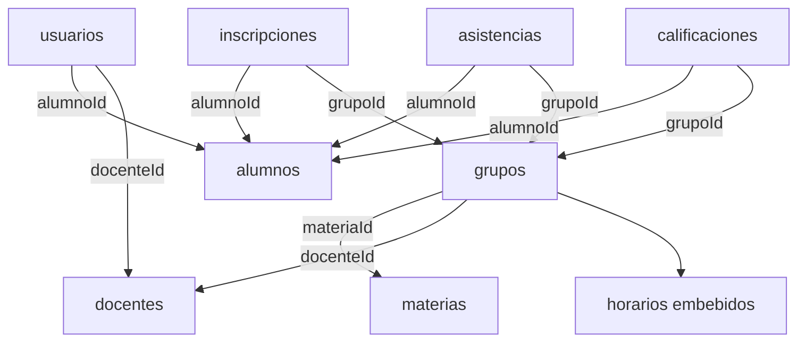

# Estructura de la base de datos

## 1. Información general

| Propiedad     | Valor            |
| ------------- | ---------------- |
| Proyecto      | Sistema Escolar  |
| Motor         | MongoDB          |
| Plataforma    | MongoDB Atlas    |
| Clúster       | ClusterEscolar   |
| Base de datos | SistemaEscolarDB |
| Backend       | Spring Boot      |
| Lenguaje      | Java 25          |
| Colecciones   | 8                |

## 2. Convenciones

- Los nombres de las colecciones se escriben en plural y minúsculas.
- Los nombres de los campos utilizan camelCase y no contienen acentos.
- Cada modelo Java utiliza un campo `id` de tipo String como identificador.
- En MongoDB, el identificador se almacena en el campo `_id`.
- Las referencias entre colecciones se almacenan como String y terminan en Id.
- Los valores de los enums se escriben en mayúsculas.
- Las fechas utilizan LocalDate o LocalDateTime, según corresponda.
- Las fechas de tipo LocalDate se almacenan como BSON Date a las 12:00 UTC para evitar cambios de día en la zona horaria de México.
- Los horarios de inicio y fin se almacenan como String con formato HH:mm.
- Los campos únicos llevan la anotación `@Indexed(unique = true)`.
- Los modelos utilizan `@Document(collection = "...")` con el nombre exacto de la colección.
- Las contraseñas se almacenan mediante hash BCrypt.
- Las bajas son lógicas mediante `activo = false` en las colecciones que contienen dicho campo.
- Los modelos deben respetar los campos definidos en este documento.

### Equivalencia de tipos

| MongoDB                          | Java                                          |
| -------------------------------- | --------------------------------------------- |
| ObjectId                         | String mediante @Id                           |
| String                           | String                                        |
| Int32                            | Integer                                       |
| Double                           | Double                                        |
| Boolean                          | Boolean                                       |
| Date                             | LocalDate o LocalDateTime mediante conversión |
| String                           | Enum                                          |
| Document                         | Clase Java                                    |
| Array                            | List                                          |

La representación BSON de los tipos de fecha y hora deberá coincidir con la configuración de conversión utilizada por Spring Data MongoDB.

## 3. Colecciones

### 3.1. usuarios

Responsable: Kevin.

Almacena las cuentas de acceso al sistema y sus respectivos roles.

| Campo Java    | Tipo Java     | Obligatorio | Restricción                                 |
| ------------- | ------------- | ----------- | ------------------------------------------- |
| id            | String        | Sí          | Identificador generado por MongoDB          |
| nombre        | String        | Sí          | Nombre del usuario                          |
| email         | String        | Sí          | Único y con formato válido                  |
| password      | String        | Sí          | Hash BCrypt                                 |
| rol           | Rol           | Sí          | ADMIN, PROFESOR o ALUMNO                    |
| alumnoId      | String        | Condicional | Referencia a alumnos si el rol es ALUMNO    |
| docenteId     | String        | Condicional | Referencia a docentes si el rol es PROFESOR |
| activo        | Boolean       | Sí          | true por defecto                            |
| fechaRegistro | LocalDateTime | Sí          | Fecha y hora de creación                    |

#### Roles permitidos

- ADMIN
- PROFESOR
- ALUMNO

#### Ejemplo

```json
{
  "_id": { "$oid": "010000000000000000000002" },
  "nombre": "Juan Garcia Lopez",
  "email": "alumno1@example.com",
  "password": "<HASH_BCRYPT>",
  "rol": "ALUMNO",
  "alumnoId": "020000000000000000000001",
  "docenteId": null,
  "activo": true,
  "fechaRegistro": {
    "$date": "2026-09-01T14:00:00Z"
  }
}
```

#### Reglas de negocio

- El correo electrónico debe ser único y válido.
- La contraseña debe almacenarse mediante BCrypt.
- La contraseña nunca debe incluirse en las respuestas de la API.
- El rol debe corresponder a uno de los valores permitidos.
- Si el rol es ALUMNO, alumnoId debe corresponder a un alumno existente.
- Si el rol es PROFESOR, docenteId debe corresponder a un docente existente.
- Los administradores no requieren alumnoId ni docenteId.
- Las cuentas se desactivan mediante activo = false.
- La fecha de registro se asigna al crear la cuenta.

### 3.2. alumnos

Responsable: Yael.

Almacena la información personal y académica de los estudiantes.

| Campo Java      | Tipo Java | Obligatorio | Restricción                        |
| --------------- | --------- | ----------- | ---------------------------------- |
| id              | String    | Sí          | Identificador generado por MongoDB |
| matricula       | String    | Sí          | Única                              |
| nombre          | String    | Sí          | No vacío                           |
| apellidoPaterno | String    | Sí          | No vacío                           |
| apellidoMaterno | String    | No          | Opcional                           |
| email           | String    | Sí          | Único y válido                     |
| telefono        | String    | No          | 10 dígitos                         |
| fechaNacimiento | LocalDate | Sí          | Fecha anterior a la actual         |
| carrera         | String    | Sí          | No vacío                           |
| semestre        | Integer   | Sí          | Entre 1 y 12                       |
| activo          | Boolean   | Sí          | true por defecto                   |

#### Ejemplo

```json
{
  "_id": { "$oid": "020000000000000000000001" },
  "matricula": "A2026001",
  "nombre": "Juan",
  "apellidoPaterno": "Garcia",
  "apellidoMaterno": "Lopez",
  "email": "alumno1@example.com",
  "telefono": "4770000001",
  "fechaNacimiento": {
    "$date": "2005-03-15T12:00:00Z"
  },
  "carrera": "Tecnologias de la Informacion",
  "semestre": 3,
  "activo": true
}
```

#### Reglas de negocio

- No permitir matrículas duplicadas.
- No permitir correos electrónicos duplicados.
- Validar el formato del correo electrónico.
- El teléfono debe contener 10 dígitos cuando se proporcione.
- La fecha de nacimiento debe estar en el pasado.
- La carrera es obligatoria.
- El semestre debe estar entre 1 y 12.
- La baja del alumno es lógica mediante activo = false.
- El alumno solamente puede consultar su propia información.
- La relación con usuarios se establece mediante usuarios.alumnoId.

### 3.3. materias

Responsable: Miguel Aguirre.

Almacena el catálogo de asignaturas del sistema escolar.

| Campo Java  | Tipo Java | Obligatorio | Restricción                        |
| ----------- | --------- | ----------- | ---------------------------------- |
| id          | String    | Sí          | Identificador generado por MongoDB |
| clave       | String    | Sí          | Única                              |
| nombre      | String    | Sí          | No vacío                           |
| descripcion | String    | No          | Opcional                           |
| creditos    | Integer   | Sí          | Entre 1 y 10                       |
| semestre    | Integer   | Sí          | Entre 1 y 12                       |
| horasSemana | Integer   | Sí          | Entre 1 y 20                       |
| activo      | Boolean   | Sí          | true por defecto                   |

#### Ejemplo

```json
{
  "_id": { "$oid": "030000000000000000000001" },
  "clave": "MAT101",
  "nombre": "Bases de Datos",
  "descripcion": "Fundamentos y administracion de bases de datos",
  "creditos": 8,
  "semestre": 3,
  "horasSemana": 5,
  "activo": true
}
```

#### Reglas de negocio

- No permitir claves duplicadas.
- Los créditos deben estar entre 1 y 10.
- El semestre debe estar entre 1 y 12.
- Las horas semanales deben estar entre 1 y 20.
- Solo el administrador puede registrar, actualizar o dar de baja materias.
- Las bajas se realizan mediante activo = false.

### 3.4. docentes

Responsable: Fermín.

Almacena la información de los profesores.

| Campo Java      | Tipo Java | Obligatorio | Restricción                        |
| --------------- | --------- | ----------- | ---------------------------------- |
| id              | String    | Sí          | Identificador generado por MongoDB |
| numeroEmpleado  | String    | Sí          | Único                              |
| nombre          | String    | Sí          | No vacío                           |
| apellidoPaterno | String    | Sí          | No vacío                           |
| apellidoMaterno | String    | No          | Opcional                           |
| email           | String    | Sí          | Único y válido                     |
| telefono        | String    | No          | 10 dígitos                         |
| especialidad    | String    | Sí          | No vacío                           |
| activo          | Boolean   | Sí          | true por defecto                   |

#### Ejemplo

```json
{
  "_id": { "$oid": "040000000000000000000001" },
  "numeroEmpleado": "D0001",
  "nombre": "Carlos",
  "apellidoPaterno": "Ramirez",
  "apellidoMaterno": "Torres",
  "email": "docente1@example.com",
  "telefono": "4771000001",
  "especialidad": "Bases de Datos",
  "activo": true
}
```

#### Reglas de negocio

- No permitir números de empleado duplicados.
- No permitir correos electrónicos duplicados.
- Validar el formato del correo electrónico.
- El teléfono debe contener 10 dígitos cuando se proporcione.
- La especialidad es obligatoria.
- Las bajas se realizan mediante activo = false.
- La relación con usuarios se establece mediante usuarios.docenteId.

### 3.5. grupos

Responsable: Fermín.

Almacena los grupos académicos, materias, docentes, periodos y horarios.

| Campo Java | Tipo Java       | Obligatorio | Restricción                        |
| ---------- | --------------- | ----------- | ---------------------------------- |
| id         | String          | Sí          | Identificador generado por MongoDB |
| clave      | String          | Sí          | Única                              |
| materiaId  | String          | Sí          | Referencia a materias              |
| docenteId  | String          | Sí          | Referencia a docentes              |
| periodo    | String          | Sí          | Periodo escolar                    |
| cupoMaximo | Integer         | Sí          | Entre 1 y 50                       |
| horarios   | List de Horario | Sí          | Al menos un horario                |
| activo     | Boolean         | Sí          | true por defecto                   |

#### Documento embebido horarios

| Campo Java | Tipo Java | Obligatorio | Restricción          |
| ---------- | --------- | ----------- | -------------------- |
| dia        | DiaSemana | Sí          | LUNES a SABADO       |
| horaInicio | String    | Sí          | Formato HH:mm        |
| horaFin    | String    | Sí          | Formato HH:mm; mayor que horaInicio |
| aula       | String    | Sí          | No vacío             |

#### Días permitidos

- LUNES
- MARTES
- MIERCOLES
- JUEVES
- VIERNES
- SABADO

#### Ejemplo

Representación lógica del grupo:

```json
{
  "_id": { "$oid": "050000000000000000000001" },
  "clave": "MAT101-A",
  "materiaId": "030000000000000000000001",
  "docenteId": "040000000000000000000001",
  "periodo": "2026-2",
  "cupoMaximo": 30,
  "horarios": [
    {
      "dia": "LUNES",
      "horaInicio": "08:00",
      "horaFin": "10:00",
      "aula": "B-204"
    },
    {
      "dia": "MIERCOLES",
      "horaInicio": "08:00",
      "horaFin": "10:00",
      "aula": "B-204"
    }
  ],
  "activo": true
}
```

#### Reglas de negocio

- La clave del grupo debe ser única.
- La materia debe existir.
- El docente debe existir.
- El cupo máximo debe estar entre 1 y 50.
- Debe existir al menos un horario.
- La hora de inicio debe ser anterior a la hora de fin.
- No permitir horarios simultáneos para el mismo docente.
- No permitir horarios simultáneos en la misma aula.
- Los horarios se almacenan dentro del grupo.
- No existe una colección independiente de horarios.
- Las bajas se realizan mediante activo = false.

### 3.6. inscripciones

Responsable: Erik.

Relaciona a los alumnos con los grupos académicos.

| Campo Java       | Tipo Java         | Obligatorio | Restricción                        |
| ---------------- | ----------------- | ----------- | ---------------------------------- |
| id               | String            | Sí          | Identificador generado por MongoDB |
| alumnoId         | String            | Sí          | Referencia a alumnos               |
| grupoId          | String            | Sí          | Referencia a grupos                |
| fechaInscripcion | LocalDate         | Sí          | Fecha de inscripción               |
| estado           | EstadoInscripcion | Sí          | INSCRITO o BAJA                    |

#### Estados permitidos

- INSCRITO
- BAJA

#### Ejemplo

```json
{
  "_id": { "$oid": "060000000000000000000001" },
  "alumnoId": "020000000000000000000001",
  "grupoId": "050000000000000000000001",
  "fechaInscripcion": {
    "$date": "2026-09-01T12:00:00Z"
  },
  "estado": "INSCRITO"
}
```

#### Reglas de negocio

- El alumno debe existir.
- El grupo debe existir.
- No permitir inscripciones duplicadas para el mismo alumno y grupo.
- No superar el cupo máximo del grupo.
- Las inscripciones con estado BAJA no ocupan cupo.
- La fecha de inscripción se asigna al crear el registro.
- La baja de una inscripción se realiza mediante estado = BAJA.

### 3.7. asistencias

Responsable: Erik.

Almacena los registros de asistencia de los alumnos.

| Campo Java  | Tipo Java        | Obligatorio | Restricción                        |
| ----------- | ---------------- | ----------- | ---------------------------------- |
| id          | String           | Sí          | Identificador generado por MongoDB |
| grupoId     | String           | Sí          | Referencia a grupos                |
| alumnoId    | String           | Sí          | Referencia a alumnos               |
| fecha       | LocalDate        | Sí          | No puede estar en el futuro        |
| estado      | EstadoAsistencia | Sí          | Estado permitido                   |
| observacion | String           | No          | Opcional                           |

#### Estados permitidos

- PRESENTE
- FALTA
- RETARDO
- JUSTIFICADA

#### Ejemplo

```json
{
  "_id": { "$oid": "070000000000000000000001" },
  "grupoId": "050000000000000000000001",
  "alumnoId": "020000000000000000000001",
  "fecha": {
    "$date": "2026-09-07T12:00:00Z"
  },
  "estado": "PRESENTE",
  "observacion": null
}
```

#### Reglas de negocio

- El grupo debe existir.
- El alumno debe existir.
- El alumno debe estar inscrito en el grupo.
- La fecha no puede estar en el futuro.
- No permitir registros duplicados para el mismo grupo, alumno y fecha.
- Solo el profesor asignado al grupo puede registrar asistencias.
- El estado debe corresponder a uno de los valores permitidos.

### 3.8. calificaciones

Responsable: Marcos.

Almacena las evaluaciones académicas de los estudiantes.

| Campo Java    | Tipo Java     | Obligatorio | Restricción                        |
| ------------- | ------------- | ----------- | ---------------------------------- |
| id            | String        | Sí          | Identificador generado por MongoDB |
| alumnoId      | String        | Sí          | Referencia a alumnos               |
| grupoId       | String        | Sí          | Referencia a grupos                |
| parcial       | Integer       | Sí          | Entre 1 y 3                        |
| calificacion  | Double        | Sí          | Entre 0 y 10                       |
| comentario    | String        | No          | Opcional                           |
| fechaRegistro | LocalDateTime | Sí          | Fecha de creación o actualización  |

#### Ejemplo

```json
{
  "_id": { "$oid": "080000000000000000000001" },
  "alumnoId": "020000000000000000000001",
  "grupoId": "050000000000000000000001",
  "parcial": 1,
  "calificacion": 8.5,
  "comentario": "Buen desempeno academico",
  "fechaRegistro": {
    "$date": "2026-09-30T16:00:00Z"
  }
}
```

#### Reglas de negocio

- El alumno debe existir.
- El grupo debe existir.
- El alumno debe estar inscrito en el grupo.
- El parcial debe estar entre 1 y 3.
- La calificación debe estar entre 0 y 10.
- No permitir calificaciones duplicadas por alumno, grupo y parcial.
- Solo el profesor asignado al grupo puede registrar calificaciones.
- El alumno únicamente puede consultar sus propias calificaciones.
- Un promedio menor a 6 se considera reprobatorio.
- La fecha de registro se asigna al crear o editar la calificación.

## 4. Relaciones entre colecciones

| Colección origen | Campo     | Colección destino | Tipo   |
| ---------------- | --------- | ----------------- | ------ |
| usuarios         | alumnoId  | alumnos           | String |
| usuarios         | docenteId | docentes          | String |
| grupos           | materiaId | materias          | String |
| grupos           | docenteId | docentes          | String |
| inscripciones    | alumnoId  | alumnos           | String |
| inscripciones    | grupoId   | grupos            | String |
| asistencias      | alumnoId  | alumnos           | String |
| asistencias      | grupoId   | grupos            | String |
| calificaciones   | alumnoId  | alumnos           | String |
| calificaciones   | grupoId   | grupos            | String |

Los alumnos y los grupos mantienen una relación muchos a muchos mediante la colección inscripciones.

Las relaciones se almacenan como cadenas de texto que contienen el identificador del documento relacionado.

MongoDB no valida automáticamente estas referencias. Los servicios de Spring Boot deben comprobar que los documentos relacionados existan antes de realizar una operación.

## 5. Diagrama de relaciones



## 6. Índices únicos

Los campos únicos deberán configurarse mediante índices en MongoDB y las anotaciones correspondientes en los modelos de Spring Boot.

### Índices simples

| Colección | Campo          |
| --------- | -------------- |
| usuarios  | email          |
| alumnos   | matricula      |
| alumnos   | email          |
| materias  | clave          |
| docentes  | numeroEmpleado |
| docentes  | email          |
| grupos    | clave          |

### Índices compuestos

| Colección      | Campos                     |
| -------------- | -------------------------- |
| inscripciones  | alumnoId, grupoId          |
| asistencias    | grupoId, alumnoId, fecha   |
| calificaciones | alumnoId, grupoId, parcial |

Los índices compuestos permiten evitar duplicados en las relaciones y registros académicos.

## 7. Registros de prueba

Cada colección contará con un mínimo de 20 documentos.

| Colección      | Cantidad prevista |
| -------------- | ----------------: |
| usuarios       |                41 |
| alumnos        |                20 |
| materias       |                20 |
| docentes       |                20 |
| grupos         |                20 |
| inscripciones  |                40 |
| asistencias    |                80 |
| calificaciones |               120 |
| Total          |               361 |

Los 41 usuarios corresponden a:

- 1 administrador.
- 20 alumnos.
- 20 profesores.

Los datos serán ficticios y se utilizarán exclusivamente para el desarrollo y las pruebas del sistema.

## 8. Orden de inserción

Los documentos se insertarán respetando sus dependencias:

1. alumnos
2. docentes
3. materias
4. usuarios
5. grupos
6. inscripciones
7. asistencias
8. calificaciones

Este orden permite que los documentos relacionados existan antes de insertar las referencias correspondientes.

## 9. Integridad de los datos

La integridad de los datos deberá garantizarse mediante:

- Validaciones en los servicios de Spring Boot.
- Índices únicos simples y compuestos.
- Validación de referencias entre colecciones.
- Validación de campos obligatorios.
- Validación de rangos numéricos.
- Validación de los valores de los enums.
- Control de acceso mediante Spring Security.
- Bajas lógicas.
- Validación de cupos y conflictos de horarios.

## 10. Script de datos de prueba

El script encargado de generar y cargar los documentos se encuentra en:

database/seed/seed.js

El script deberá:

- Generar al menos 20 documentos por colección.
- Respetar los nombres y tipos establecidos en este documento.
- Generar referencias válidas de tipo String.
- Almacenar contraseñas mediante BCrypt.
- Evitar matrículas, correos y claves duplicadas.
- Respetar los cupos máximos de los grupos.
- Evitar conflictos de horarios.
- Generar asistencias y calificaciones de alumnos inscritos.
- Respetar los valores de los enums.
- Evitar eliminar o sobrescribir información existente sin autorización.
- Mantener las credenciales fuera del código fuente.

Las credenciales deberán configurarse mediante variables de entorno y nunca deberán subirse al repositorio.

## 11. Responsable

Encargado de la base de datos: Yayo.

Rama de desarrollo: feature/database.
