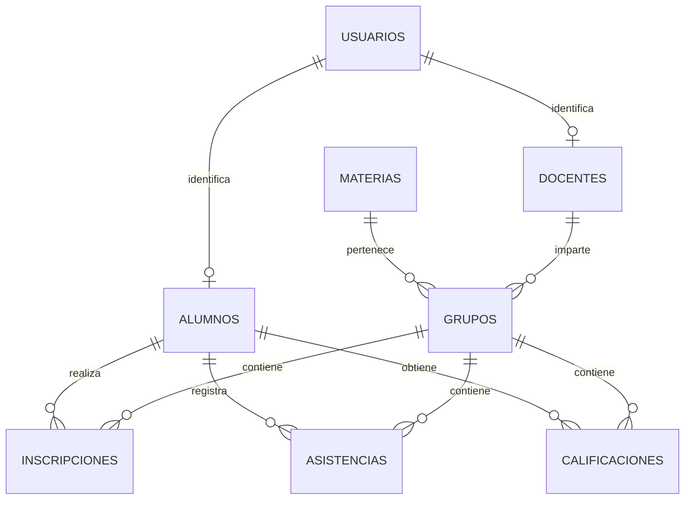

# Estructura de la base de datos

## 1. Información general

| Propiedad     | Valor            |
| ------------- | ---------------- |
| Proyecto      | Sistema Escolar  |
| Motor         | MongoDB          |
| Plataforma    | MongoDB Atlas    |
| Clúster       | ClusterEscolar   |
| Base de datos | SistemaEscolarDB |
| Backend       | Spring Boot      |
| Lenguaje      | Java 25          |
| Colecciones   | 8                |

## 2. Convenciones

- Los nombres de las colecciones se escriben en plural y minúsculas.
- Los nombres de los campos utilizan camelCase.
- Cada documento cuenta con un identificador `_id` de tipo ObjectId.
- Las relaciones entre colecciones utilizan referencias ObjectId.
- Las fechas se almacenan como BSON Date.
- Las contraseñas se almacenan mediante hash BCrypt.
- Los modelos de Spring Boot deben respetar los nombres de los campos definidos en este documento.

### Equivalencia de tipos

| MongoDB  | Java                                  |
| -------- | ------------------------------------- |
| ObjectId | ObjectId o String con conversión BSON |
| String   | String                                |
| Int32    | Integer                               |
| Double   | Double                                |
| Date     | Instant                               |
| Document | Clase Java                            |
| Boolean  | Boolean                               |

## 3. Colecciones

### 3.1. usuarios

Responsable: Kevin.

Almacena las credenciales y roles de acceso al sistema.

| Campo    | Tipo BSON | Obligatorio | Restricción         |
| -------- | --------- | ----------- | ------------------- |
| \_id     | ObjectId  | Sí          | Identificador único |
| email    | String    | Sí          | Único y válido      |
| password | String    | Sí          | Hash BCrypt         |
| rol      | String    | Sí          | Rol permitido       |

Roles permitidos:

- ADMINISTRADOR
- PROFESOR
- ALUMNO

Ejemplo:

```json
{
  "_id": { "$oid": "670000000000000000000001" },
  "email": "alumno01@example.com",
  "password": "<HASH_BCRYPT>",
  "rol": "ALUMNO"
}
```

### 3.2. alumnos

Responsable: Yayo.

Almacena la información personal y académica de los estudiantes.

| Campo     | Tipo BSON | Obligatorio | Restricción           |
| --------- | --------- | ----------- | --------------------- |
| \_id      | ObjectId  | Sí          | Identificador único   |
| usuarioId | ObjectId  | Sí          | Referencia a usuarios |
| matricula | String    | Sí          | Única                 |
| nombre    | String    | Sí          | No vacío              |
| apellidos | String    | Sí          | No vacío              |
| email     | String    | Sí          | Correo válido         |
| semestre  | Int32     | Sí          | Mayor a 0             |

Ejemplo:

```json
{
  "_id": { "$oid": "670000000000000000000101" },
  "usuarioId": { "$oid": "670000000000000000000001" },
  "matricula": "20260001",
  "nombre": "Juan",
  "apellidos": "Perez Lopez",
  "email": "alumno01@example.com",
  "semestre": 3
}
```

Reglas de negocio:

- No permitir matrículas duplicadas.
- Validar el formato del correo electrónico.
- El usuario relacionado debe tener el rol ALUMNO.
- El alumno únicamente puede consultar su propia información.
- El correo debe coincidir con el de su usuario relacionado.

### 3.3. materias

Responsable: Miguel Aguirre.

Almacena las asignaturas del sistema escolar.

| Campo    | Tipo BSON | Obligatorio | Restricción         |
| -------- | --------- | ----------- | ------------------- |
| \_id     | ObjectId  | Sí          | Identificador único |
| clave    | String    | Sí          | Única               |
| nombre   | String    | Sí          | No vacío            |
| creditos | Int32     | Sí          | Mayor a 0           |
| semestre | Int32     | Sí          | Mayor a 0           |

Ejemplo:

```json
{
  "_id": { "$oid": "670000000000000000000201" },
  "clave": "MAT001",
  "nombre": "Bases de Datos",
  "creditos": 8,
  "semestre": 3
}
```

Reglas de negocio:

- No permitir claves duplicadas.
- Los créditos deben ser mayores a cero.
- Solo el administrador puede registrar, actualizar o eliminar materias.

### 3.4. docentes

Responsable: Fermín.

Almacena la información de los profesores.

| Campo          | Tipo BSON | Obligatorio | Restricción           |
| -------------- | --------- | ----------- | --------------------- |
| \_id           | ObjectId  | Sí          | Identificador único   |
| usuarioId      | ObjectId  | Sí          | Referencia a usuarios |
| numeroEmpleado | String    | Sí          | Único                 |
| nombre         | String    | Sí          | No vacío              |
| email          | String    | Sí          | Correo válido         |
| especialidad   | String    | Sí          | No vacío              |

Ejemplo:

```json
{
  "_id": { "$oid": "670000000000000000000301" },
  "usuarioId": { "$oid": "670000000000000000000021" },
  "numeroEmpleado": "DOC001",
  "nombre": "Carlos Ramirez",
  "email": "docente01@example.com",
  "especialidad": "Tecnologias de la Informacion"
}
```

Reglas de negocio:

- No permitir números de empleado duplicados.
- Validar el correo electrónico.
- El usuario relacionado debe tener el rol PROFESOR.
- El correo debe coincidir con el de su usuario relacionado.

### 3.5. grupos

Responsable: Fermín.

Almacena los grupos, docentes, materias y horarios.

| Campo     | Tipo BSON | Obligatorio | Restricción           |
| --------- | --------- | ----------- | --------------------- |
| \_id      | ObjectId  | Sí          | Identificador único   |
| materiaId | ObjectId  | Sí          | Referencia a materias |
| docenteId | ObjectId  | Sí          | Referencia a docentes |
| periodo   | String    | Sí          | Periodo escolar       |
| cupo      | Int32     | Sí          | Mayor a 0             |
| horario   | Document  | Sí          | Horario del grupo     |

#### Documento embebido horario

| Campo      | Tipo BSON | Obligatorio | Restricción      |
| ---------- | --------- | ----------- | ---------------- |
| dia        | String    | Sí          | Día de la semana |
| horaInicio | String    | Sí          | Formato HH:mm    |
| horaFin    | String    | Sí          | Formato HH:mm    |
| aula       | String    | Sí          | No vacío         |

Ejemplo:

```json
{
  "_id": { "$oid": "670000000000000000000401" },
  "materiaId": { "$oid": "670000000000000000000201" },
  "docenteId": { "$oid": "670000000000000000000301" },
  "periodo": "2026-3",
  "cupo": 30,
  "horario": {
    "dia": "LUNES",
    "horaInicio": "08:00",
    "horaFin": "10:00",
    "aula": "A101"
  }
}
```

Reglas de negocio:

- La materia debe existir.
- El docente debe existir.
- El cupo debe ser mayor a cero.
- La hora de inicio debe ser anterior a la hora de fin.
- No permitir horarios simultáneos para el mismo docente.
- No permitir horarios simultáneos en la misma aula.

### 3.6. inscripciones

Responsable: Erik.

Relaciona a los alumnos con los grupos.

| Campo    | Tipo BSON | Obligatorio | Restricción          |
| -------- | --------- | ----------- | -------------------- |
| \_id     | ObjectId  | Sí          | Identificador único  |
| alumnoId | ObjectId  | Sí          | Referencia a alumnos |
| grupoId  | ObjectId  | Sí          | Referencia a grupos  |
| fecha    | Date      | Sí          | Fecha de inscripción |
| estado   | String    | Sí          | ACTIVA o BAJA        |

Ejemplo:

```json
{
  "_id": { "$oid": "670000000000000000000501" },
  "alumnoId": { "$oid": "670000000000000000000101" },
  "grupoId": { "$oid": "670000000000000000000401" },
  "fecha": { "$date": "2026-09-01T00:00:00Z" },
  "estado": "ACTIVA"
}
```

Reglas de negocio:

- El alumno debe existir.
- El grupo debe existir.
- No permitir inscripciones duplicadas.
- No superar el cupo máximo del grupo.
- Las inscripciones con estado BAJA no ocupan cupo.

### 3.7. asistencias

Responsable: Erik.

Almacena los registros de asistencia de los alumnos.

| Campo    | Tipo BSON | Obligatorio | Restricción          |
| -------- | --------- | ----------- | -------------------- |
| \_id     | ObjectId  | Sí          | Identificador único  |
| alumnoId | ObjectId  | Sí          | Referencia a alumnos |
| grupoId  | ObjectId  | Sí          | Referencia a grupos  |
| fecha    | Date      | Sí          | Fecha de asistencia  |
| estado   | String    | Sí          | Estado permitido     |

Estados permitidos:

- PRESENTE
- FALTA
- RETARDO

Ejemplo:

```json
{
  "_id": { "$oid": "670000000000000000000601" },
  "alumnoId": { "$oid": "670000000000000000000101" },
  "grupoId": { "$oid": "670000000000000000000401" },
  "fecha": { "$date": "2026-09-07T00:00:00Z" },
  "estado": "PRESENTE"
}
```

Reglas de negocio:

- El alumno debe estar inscrito en el grupo.
- Solo el profesor asignado al grupo puede registrar asistencias.
- No permitir registros duplicados para el mismo alumno, grupo y fecha.
- Normalizar las fechas a un mismo criterio antes de guardar.

### 3.8. calificaciones

Responsable: Marcos.

Almacena las evaluaciones académicas de los estudiantes.

| Campo        | Tipo BSON | Obligatorio | Restricción          |
| ------------ | --------- | ----------- | -------------------- |
| \_id         | ObjectId  | Sí          | Identificador único  |
| alumnoId     | ObjectId  | Sí          | Referencia a alumnos |
| grupoId      | ObjectId  | Sí          | Referencia a grupos  |
| parcial      | Int32     | Sí          | Mayor a 0            |
| calificacion | Double    | Sí          | Entre 0 y 10         |

Ejemplo:

```json
{
  "_id": { "$oid": "670000000000000000000701" },
  "alumnoId": { "$oid": "670000000000000000000101" },
  "grupoId": { "$oid": "670000000000000000000401" },
  "parcial": 1,
  "calificacion": 8.5
}
```

Reglas de negocio:

- La calificación debe estar entre 0 y 10.
- El alumno debe estar inscrito en el grupo.
- Solo el profesor asignado al grupo puede registrar calificaciones.
- No permitir calificaciones duplicadas por alumno, grupo y parcial.
- El alumno únicamente puede consultar sus propias calificaciones.

## 4. Relaciones entre colecciones

| Colección origen | Campo     | Colección destino | Cardinalidad |
| ---------------- | --------- | ----------------- | ------------ |
| alumnos          | usuarioId | usuarios          | 1:1          |
| docentes         | usuarioId | usuarios          | 1:1          |
| grupos           | materiaId | materias          | N:1          |
| grupos           | docenteId | docentes          | N:1          |
| inscripciones    | alumnoId  | alumnos           | N:1          |
| inscripciones    | grupoId   | grupos            | N:1          |
| asistencias      | alumnoId  | alumnos           | N:1          |
| asistencias      | grupoId   | grupos            | N:1          |
| calificaciones   | alumnoId  | alumnos           | N:1          |
| calificaciones   | grupoId   | grupos            | N:1          |

Los alumnos y grupos mantienen una relación muchos a muchos mediante la colección inscripciones.

## 5. Diagrama de relaciones



## 6. Índices únicos

Los siguientes índices deberán configurarse en MongoDB para evitar registros duplicados.

| Colección      | Campos del índice          |
| -------------- | -------------------------- |
| usuarios       | email                      |
| alumnos        | matricula                  |
| alumnos        | usuarioId                  |
| materias       | clave                      |
| docentes       | numeroEmpleado             |
| docentes       | usuarioId                  |
| inscripciones  | alumnoId, grupoId          |
| asistencias    | alumnoId, grupoId, fecha   |
| calificaciones | alumnoId, grupoId, parcial |

## 7. Registros de prueba

Cada colección contará con un mínimo de 20 documentos.

| Colección      | Cantidad prevista |
| -------------- | ----------------: |
| usuarios       |                41 |
| alumnos        |                20 |
| materias       |                20 |
| docentes       |                20 |
| grupos         |                20 |
| inscripciones  |                40 |
| asistencias    |                80 |
| calificaciones |               120 |
| Total          |               361 |

Los 41 usuarios corresponden a:

- 1 administrador.
- 20 alumnos.
- 20 profesores.

## 8. Orden de inserción

Para garantizar que las referencias correspondan a documentos existentes, los datos de prueba se insertarán en el siguiente orden:

1. usuarios
2. alumnos
3. materias
4. docentes
5. grupos
6. inscripciones
7. asistencias
8. calificaciones

## 9. Integridad de los datos

MongoDB no implementa claves foráneas relacionales de manera automática.

La integridad de las referencias deberá garantizarse mediante:

- Validaciones en los servicios de Spring Boot.
- Índices únicos en MongoDB.
- Verificación de documentos relacionados.
- Validaciones de las reglas de negocio.
- Control de acceso mediante Spring Security.

## 10. Script de datos de prueba

El script encargado de generar y cargar los registros se encontrará en:

database/seed/seed.js

El script deberá:

- Insertar un mínimo de 20 registros por colección.
- Generar referencias válidas.
- Almacenar contraseñas mediante BCrypt.
- Evitar matrículas y claves duplicadas.
- Respetar los cupos de los grupos.
- Generar asistencias y calificaciones de alumnos inscritos.
- Evitar eliminar información existente.
- Mantener las credenciales fuera del código fuente.

## 11. Responsable

Encargado de la base de datos: Yayo.

Rama de desarrollo: feature/database.
